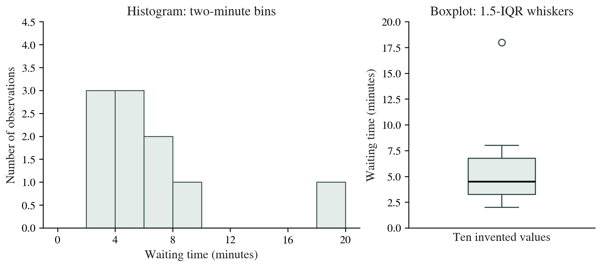
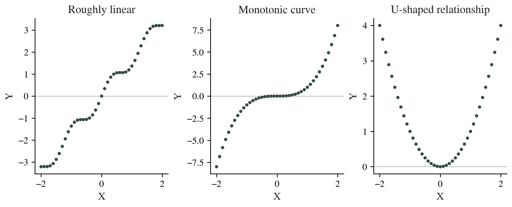

# Graphical Presentation {#sec-graphical-presentation}

## Learning objectives

After this chapter, the reader should be able to select a graph for a stated question, distinguish a categorical bar chart from a histogram, interpret distributional and relationship plots, and label uncertainty without confusing it with individual variation.

## Let the question determine the graph

A graph should make one analytical task easier. A bar chart compares counts or proportions across categories. A histogram describes the distribution of a quantitative measurement. A scatterplot examines the relationship between two quantitative variables. A point with an interval displays an estimate and its uncertainty.

Before creating a graph, state what the reader should be able to see. "Compare the event proportions across groups" is a clearer task than "make a chart of the dataset." The first task determines the denominator, category labels, and axis scale; the second leaves those decisions unresolved.

| Analytical question | Useful graph | Essential context |
|:--------------------|:-------------|:------------------|
| How many observations are in each category? | Bar chart | Counts, category definitions, and total |
| How is a quantitative variable distributed? | Histogram or distribution plot | Measurement unit, binning, and available n |
| How do distributions differ across groups? | Boxplot with individual points when feasible | Group n, median/quartile definition, and units |
| How do paired values change? | Paired-point plot with connecting lines | Participant matching and time order |
| Do two measurements vary together? | Scatterplot | Both units, observation unit, and relevant groups |
| How precise is an estimate? | Point and interval plot | Estimate, interval meaning, confidence level, and reference value |

This table is a design guide for the manuscript. It should be applied to the specific question rather than used as an automatic conversion from variable type to picture.

## Bar charts for categories

Use separate bars for categories and label the axis as a count or percentage. Absolute count bars should start at zero so that their lengths correspond to the values. If percentages are shown, state whether they use the total sample, a group denominator, or only observations with known status.

For nominal categories, ordering may follow a meaningful convention or the magnitude of the count. For ordinal categories, preserve the order of the scale. Sorting mild, moderate, and severe by frequency would make the display harder to interpret as an ordered severity distribution.

Avoid three-dimensional effects and decorative shapes that make lengths difficult to compare. A pie chart can show a coarse part-to-whole division with a few exclusive categories, but a bar chart usually makes precise comparisons easier. If category membership overlaps, the displayed percentages should not be presented as parts of one exclusive whole.

## Histograms for numerical distributions

A histogram divides a numerical axis into intervals and counts observations within them. It can show location, spread, asymmetry, multiple peaks, and potential unusual observations. The width of the intervals affects the apparent shape, so interpretation should not depend on one arbitrary choice of bins. [@NISTHist]

Unlike a categorical bar chart, neighbouring histogram bins represent adjacent numerical intervals. The horizontal axis therefore retains a quantitative scale. Label the vertical axis accurately: frequency, relative frequency, or density are different representations and should not be used interchangeably.

The invented waiting times from the descriptive chapter illustrate a long upper tail. Most values are between 2 and 8 minutes, with one value of 18 minutes. The histogram shows where values are concentrated; the boxplot shows the central interval and the separated high observation.

{#fig-waiting-distribution width=100% fig-alt="A histogram places nine waiting times between two and eight minutes and one at eighteen minutes. A boxplot shows the median and central quartiles with eighteen minutes beyond the upper whisker."}

A second peak may represent a mixture of groups, a change in measurement procedures, or a feature of the underlying distribution. Inspect relevant grouping and timing variables before treating the pooled distribution as one homogeneous sample.

## Boxplots and individual points

A boxplot usually displays the median and first–third quartile interval. A common fenced version uses whiskers extending to the most extreme observations within 1.5 IQR of the quartiles and displays observations beyond those limits separately. The whisker convention must be understood because it can differ across implementations. [@NISTBox]

An observation beyond a whisker is flagged by a plotting rule; the graph has not established that it is erroneous. Verify the source and examine its relevance to the question. A valid high value may be an important part of the distribution.

For small groups, displaying individual observations alongside a boxplot can make the amount of data visible. A boxplot alone may hide whether a group has five observations or fifty. Show the group sample sizes and use a consistent scale across panels when comparing magnitudes.

## Q–Q plots and distributional assumptions

A normal Q–Q plot compares the ordered observed values with values expected under a normal reference distribution. Approximate alignment with a straight line supports a normal approximation; systematic bends or tail departures identify features needing further assessment. In a regression, the relevant plot is typically for residuals rather than for every raw predictor. [@NISTQQ]

A Q–Q plot does not replace the design assumptions. Perfectly aligned observations can still come from repeated measurements treated incorrectly as independent. Conversely, a small tail departure does not by itself identify the best alternative analysis. Interpret the plot alongside sample size, unusual observations, and the target quantity.

## Scatterplots before correlation

Plot one point per defined observation unit with the two variables on numerical axes. Inspect direction, form, spread, unusual points, and possible subgroups. A straight upward pattern suggests a positive linear relationship. A steadily increasing curve is monotonic but not necessarily linear. A U-shaped pattern can contain a strong relationship even when its linear correlation is close to zero.

{#fig-relationship-patterns width=100% fig-alt="Three scatterplots show an upward nearly straight pattern, an increasing cubic curve, and a U-shaped curve with symmetric left and right sides."}

Do not draw connecting lines between unrelated individuals. Lines imply an order or a relationship between adjacent points. Use a line only when the connection represents something defined, such as repeated measurements from one participant or an ordered time series.

The correlation chapter develops the distinction between Pearson's linear coefficient and Spearman's rank-based coefficient. The scatterplot provides the context in which those numbers should be read. [@RCor]

## Paired measurements and time

For two measurements from the same participant, connecting that participant's two values preserves the matching. A plot of change values can then show whether changes are consistently in one direction or whether a few participants account for most of the mean change.

If follow-up times differ, state the time definition and window. A line from baseline to a common follow-up label should not conceal that observations were taken at substantially different times. More extensive longitudinal patterns require a design and analysis that account for their repeated structure.

## Display uncertainty explicitly

An interval around a mean may describe a confidence interval, one standard deviation, a standard error, or a prediction interval. These have different meanings. State the interval type and level in the caption; a label of "error bars" alone is insufficient.

A CI for a mean describes estimation uncertainty. An SD describes individual spread. A prediction interval concerns a new observation under its model. A narrow CI therefore does not imply that individual values are tightly clustered. Similarly, overlap between two separate group intervals is not a direct test of the difference between those groups.

When the research question concerns a contrast, display the contrast itself with its interval and a relevant reference value. For a mean difference, the no-difference value is zero; for a ratio, the null value is one. Explain the chosen direction and scale in the caption.

## Build a self-contained caption

A useful caption identifies the population or illustrative context, outcome and unit, groups or time points, sample size, and meaning of plotted summaries. If a graph shows invented teaching values, label them as invented. If a scale is transformed, state the transformation.

For example: "Distribution of invented waiting times for 10 observations. The histogram uses two-minute bins. The box shows the median and first–third quartiles; whiskers follow the 1.5-IQR convention. Points beyond the whiskers are plotted individually."

The ICMJE guidance describes figures as part of the scientific report and requires units and legends that allow their meaning to be assessed. Apply that principle to a teaching figure as well as to a manuscript figure. [@ICMJE]

## Common errors

Avoid missing denominators, unexplained axis truncation, different units across comparable panels, decorative three-dimensional bars, lines joining unrelated observations, and uncertainty intervals without a definition. Check the graph at its final printed size; a readable analysis window can become unreadable when reduced to a book page.

## Hands-on {#hands-on-graphical-presentation}

::: {.callout-note .hands-on-note title="jamovi workspace" icon=false}
<!-- Author: add jamovi graph procedures, datasets, screenshots, and exported figures here. -->
:::

::: {.review-questions}

## Review questions

1. What distinguishes a histogram from a categorical bar chart?
2. Does a point outside a boxplot whisker establish a data-entry error?
3. Why should a graph caption define what its intervals represent?

:::

::: {.review-answers}

## Answers and reasoning

1. Histogram bins represent adjacent numerical intervals; categories in a bar chart are discrete labels or levels.
2. No. The point is flagged by the plotting convention and needs source verification and analytical assessment.
3. CI, SD, SE, and prediction intervals answer different questions. The reader cannot infer the intended meaning from an unlabelled bar.

:::
