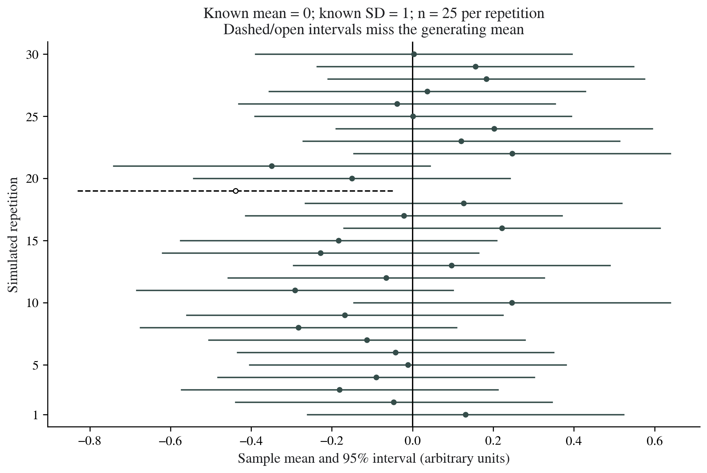

# Estimation and Hypothesis Testing {#sec-hypothesis-testing}

## Learning objectives

After this chapter, the reader should be able to define a null hypothesis on the correct scale; explain a p-value and confidence interval; distinguish statistical from clinical importance; interpret Type I and Type II errors; and recognise why a non-significant result does not establish equivalence.

## Begin with an estimate

Suppose the question is whether mean follow-up blood pressure differs between groups A and B. The target quantity is the population mean in A minus the population mean in B. The sample provides an estimate of that quantity. A statistical analysis should report the estimate and its uncertainty even when it also conducts a hypothesis test.

The null value depends on the scale. A difference of zero represents no difference; a ratio of one represents equal quantities. Testing an odds ratio against zero would therefore be a scale error. Specify the estimand, group direction, and null value before interpreting the output.

## Sampling distributions and the normal model

A sampling distribution describes how an estimator varies across repeated samples. It is different from the distribution of individual measurements in one sample. A normal distribution is symmetric and is described by a mean and standard deviation; the standard normal has mean zero and SD one. [@NISTNormal]

Under appropriate conditions, including independent, identically distributed sampling and finite positive variance in the basic version, the central limit theorem makes the distribution of a properly standardised sample mean approach a normal distribution as sample size increases. This does not require the individual measurements themselves to become normal. There is no universal sample-size cutoff that removes all problems from heavy tails, dependence, or influential observations. [@PSUCLT]

The t-based intervals introduced here account for estimating the unknown variance under the conventional model. Always connect the reference distribution to the statistic and assumptions rather than treating "normality" as a label applied to an entire dataset.

## Null and alternative hypotheses

The null hypothesis is the specified value or relationship being evaluated by a test. For a two-group mean comparison,

$$
H_0:\mu_A-\mu_B=0.
$$

A two-sided alternative is

$$
H_1:\mu_A-\mu_B\ne0.
$$

The model includes more than this equation: it also contains assumptions about the observations and their distribution. A p-value must be interpreted in relation to that model, not as a free-standing measure of truth.

A one-sided alternative addresses a prespecified direction. It should be justified by the question before the results are examined. Switching to a one-sided test after observing the direction of a difference changes the analysis procedure and its error properties.

## What a p-value means

A p-value is the probability, under the specified null model, of a test statistic at least as incompatible with that model as the observed statistic, according to the chosen test. It is not the probability that the null hypothesis is true, the probability that the results arose "by chance," or the magnitude of the effect. [@ASAp]

The conditioning is essential: the calculation begins by assuming the null model and evaluating the observed statistic within it. It does not assign a probability to the model itself. A small value identifies incompatibility with the null model but does not identify which assumption or feature accounts for that incompatibility.

Read the p-value alongside the estimate, CI, sample size, design, and analysis decisions. An extremely small difference can produce a small p-value in a large sample. A substantial estimate can have a large p-value when the data provide little precision. Neither situation is resolved by the threshold alone.

## Confidence intervals and sampling uncertainty

A confidence interval is produced by a procedure intended to cover a population parameter at a stated rate under its assumptions. In repeated sampling, a 95% procedure covers the parameter in approximately 95% of repetitions. Once one interval is observed, the fixed parameter is either inside or outside it; the confidence level is not a frequentist probability assigned to that particular inclusion. [@NISTCI]

The interval can be read as a range of parameter values compatible with the observed data and model according to the interval procedure. This interpretation remains conditional on the design and analysis assumptions. It does not incorporate every possible bias or guarantee that values just outside the limits are impossible.

{#fig-confidence-coverage width=100% fig-alt="Thirty confidence intervals are shown around means from simulated samples. A vertical line marks the known generating mean; intervals missing that mean use a different line style."}

The figure demonstrates coverage across repetitions. It does not show 30 plausible positions for the same observed interval, and it is not a clinical dataset. Individual simulations need not yield exactly 95% coverage in a finite set of repetitions.

## Precision and clinical importance

Precision concerns the uncertainty of an estimate. Clinical importance concerns whether its magnitude matters for the stated clinical or research objective. Establish the relevant threshold or interpretation using subject knowledge and appropriate sources before drawing a conclusion. A teaching threshold should be labelled as illustrative.

Consider three invented results for the same mean contrast:

| Estimate and 95% CI, mmHg | What the result shows | What it does not establish |
|:-------------------------|:----------------------|:---------------------------|
| −6.0, CI −11.4 to −0.6 | Negative estimate with an interval excluding zero | A precisely established reduction of at least an illustrative 5 mmHg |
| −6.0, CI −13.0 to 1.0 | Negative estimate with substantial uncertainty, including zero | Absence of a clinically relevant difference |
| −1.0, CI −2.0 to −0.1 | Small negative estimate with an interval excluding zero | Clinical importance merely because zero is excluded |

The second and third intervals are schematic teaching examples, not calculated study results. The first is reproduced in the two-group chapter. All three require a stated clinical question before being described as useful or important.

## Type I and Type II errors

A Type I error is rejection of a true null hypothesis under the test procedure. The significance level, alpha, sets its nominal control under the relevant assumptions. A Type II error is failure to reject the null when a specified alternative is true. Power is one minus the Type II error probability for that alternative. [@NISTTesting]

Power is not a property of a sample size alone. It depends on the specified effect, variability, analysis, significance level, and other design features. A study can have good power for a large effect and poor power for a smaller effect. Define the effect that matters before calculating the required sample size. R's power calculation documentation makes these inputs explicit for t-tests. [@RPowerT]

Do not interpret alpha as the probability that a particular positive result is false. That statement conditions on a different event and requires additional information. Similarly, planned power is not the probability that one non-significant result is a false negative. The probability definitions concern repetitions of a specified procedure and model.

## Non-significance and equivalence

When a test does not reject the null, the data may be compatible with zero and with a range of non-zero values. The CI indicates how broad that range is. A statement of "no difference" is especially misleading when the interval includes differences that would matter for the study objective. [@BMJAbsence]

Equivalence and non-inferiority require their own prespecified margins, hypotheses, and analyses. A conventional superiority test with p greater than 0.05 does not answer those questions. In this volume, report the estimated difference and interval, then explain whether the remaining uncertainty includes relevant effects.

## Multiple analyses and selective interpretation

If many outcomes or subgroup comparisons are tested, the opportunity to obtain a small p-value somewhere increases. Define the primary question and distinguish prespecified analyses from exploration. Where multiple comparisons belong to one inferential family, select and report a suitable adjustment strategy. [@RPadjust]

Adjusting p-values does not repair selective reporting of only the most favourable analysis. Report the relevant analysis family and explain which conclusions are confirmatory and which are exploratory. A change in method after seeing the result should be documented with its reason.

## Assumptions belong to the interpretation

Every test is attached to an observation structure and a statistical model. Independence, pairing, category definitions, and measurement units should be checked before examining distributional assumptions. A normality check cannot establish that repeated observations are independent.

A diagnostic test's non-significant result does not prove that its null hypothesis is true. Use plots, design information, and the sensitivity of the intended analysis to departures, rather than choosing methods solely by whether a preliminary p-value falls above or below 0.05. [@Greenland2016]

## Reporting an inferential result

A clear statement identifies the comparison and analytical sample, gives the estimate with units, reports the CI and method, and includes the test result when it is relevant. Its interpretation should remain proportionate to the design and uncertainty.

For the calculated teaching contrast: "Mean follow-up systolic blood pressure was 6.0 mmHg lower in group A than in group B (A minus B: −6.0 mmHg; 95% CI −11.4 to −0.6; Welch's two-sided p = 0.031). The interval allows effects smaller and larger than the illustrative 5-mmHg threshold, so the estimate does not establish that the reduction is at least 5 mmHg."

## Hands-on {#hands-on-hypothesis-testing}

::: {.callout-note .hands-on-note title="jamovi workspace" icon=false}
<!-- Author: add uncertainty demonstrations, jamovi settings, dataset, and screenshots here. -->
:::

::: {.review-questions}

## Review questions

1. Why is p = 0.03 not the probability that the null hypothesis is true?
2. A mean difference is −6 with CI −13 to 1. Does this establish no difference?
3. What is the no-association value for an odds ratio?
4. Why is power incomplete without a specified alternative effect?

:::

::: {.review-answers}

## Answers and reasoning

1. The p-value is calculated conditional on the null model and concerns the test statistic, not the probability of the model.
2. No. The interval includes zero and meaningful negative values; the estimate remains uncertain.
3. One. Equal odds give a ratio of one.
4. The chance of rejecting the null changes with the alternative effect. One design can detect a large effect more readily than a smaller one.

:::
