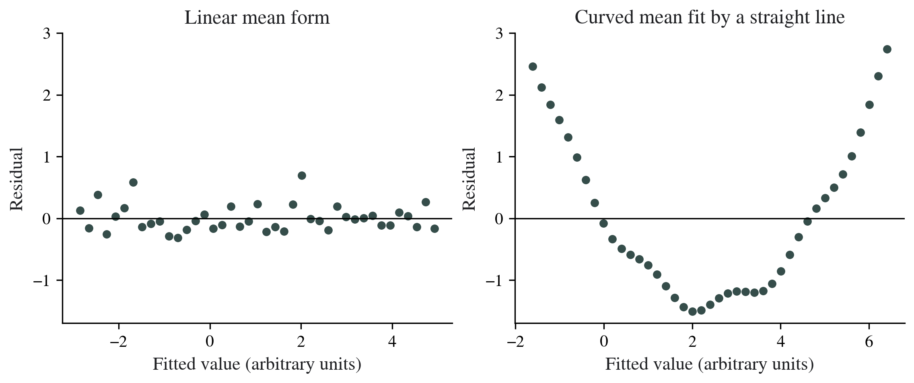

# Introduction to Simple Linear Regression {#sec-linear-regression}

## Learning objectives

After this chapter, the reader should be able to specify a continuous outcome and one predictor, interpret an original-scale slope and intercept, distinguish fitted values from residuals, recognise the assumptions for conventional inference, and separate estimation of a mean from prediction of an individual value.

## Specify the outcome and predictor

Suppose the question is how mean systolic blood pressure varies with age in the observed study population. Blood pressure is the outcome, and age is the predictor. Each independent participant contributes an outcome–predictor pair.

Simple regression uses one predictor. It does not estimate an effect independent of all other patient characteristics. Multiple predictors, confounder selection, interaction, and adjusted interpretation are reserved for Volume II and beyond. Calling a coefficient "independent" merely because it appears in a regression table would overstate this model.

## The simple linear model

The model expresses the outcome as

$$
Y_i=\beta_0+\beta_1X_i+\varepsilon_i,
\qquad E(\varepsilon_i\mid X_i)=0.
$$

The intercept $\beta_0$ is the model's conditional mean when $X=0$. The slope $\beta_1$ is the difference in conditional mean associated with a one-unit increase in $X$. The error represents the departure of an individual outcome from that conditional mean.

Ordinary least squares chooses coefficients that minimise the sum of squared residuals. R's `lm()` documentation identifies this as a route for fitting linear models and describes the model specification. [@RLm]

The model is linear in its coefficients. The basic chapter uses a straight-line relationship with one predictor so that the slope's units and interpretation are clear. More flexible relationships are developed later rather than forced into the same interpretation.

## Interpret the slope in its units

In a deliberately specified teaching equation,

$$
\widehat{\text{SBP}}=100+0.50\times\text{age},
$$

the slope is 0.50 mmHg per year. A ten-year age difference corresponds to a five-mmHg difference in the fitted conditional mean under this equation. It is an association in the specified model, not a claim that changing age causes blood pressure to change.

The fitted mean at age 40 is 120 mmHg; at age 50 it is 125 mmHg. These are values generated by the teaching equation, not predictions validated in a clinical population. Do not use them to guide care.

Scaling the predictor changes the numerical coefficient without changing the underlying fitted relationship. If age is expressed in decades, the same slope becomes 5.0 mmHg per decade. Always state the predictor unit.

## Interpret the intercept only where meaningful

The teaching equation gives an intercept of 100 mmHg at age zero. If the study includes adults only, age zero is outside the observed range. The intercept is part of the mathematical equation but may not have a useful substantive interpretation in that study.

Centering age at 40 would write the same fitted relationship as

$$
\widehat{\text{SBP}}=120+0.50\times(\text{age}-40).
$$

The intercept now describes the fitted mean at age 40, while the slope and fitted values are unchanged. This illustrates why a reference value can make an intercept easier to interpret.

## Fitted values and residuals

A fitted value is the outcome value on the estimated mean line for a given predictor value. A residual is observed minus fitted:

$$
e_i=y_i-\hat y_i.
$$

If an invented participant aged 40 has observed SBP 132 mmHg, the teaching equation gives a fitted value of 120 and a residual of +12 mmHg. The residual indicates where that observation lies relative to the mean line; it is not a model coefficient.

Residual plots assess whether the mean relationship and error structure are suitable. Curvature, changing spread, and influential observations can identify aspects that a single fit summary conceals. NIST emphasises that a high $R^2$ does not establish adequate model fit. [@NISTRegDiagnostics]

{#fig-regression-diagnostics width=100% fig-alt="Two residual plots compare an approximately pattern-free set of residuals with a U-shaped residual pattern after a straight line is fit to curved coordinates."}

## Assumptions and what they are needed for

The conditional mean should be represented adequately by the specified model. Observation or error dependence should be handled according to the study design. The conventional equal-variance SE assumes an appropriate constant error variance. Normality of errors supplies the conventional exact small-sample t inference, rather than a requirement that the raw predictor be normally distributed.

These conditions have different roles. It is possible to calculate an ordinary least-squares line without establishing that its usual confidence interval is valid. Examine the estimation and inference assumptions separately instead of treating "the regression ran" as confirmation of both.

| Check | What to inspect | Interpretation |
|:------|:----------------|:---------------|
| Mean relationship | Outcome–predictor plot and residual pattern | A curve can suggest the straight-line mean is inadequate |
| Observation structure | Sampling, repeated records, and clusters | Dependence requires a suitable model or variance approach |
| Error spread | Residuals across fitted values | Changing spread can affect the usual SE calculation |
| Error distribution | Residual Q–Q plot | Relevant to conventional small-sample inference |
| Influence | Verified unusual predictor or outcome combinations | Assess effect on the fit; do not delete automatically |

A high-leverage observation is unusual in its predictor position. A large residual is unusual relative to the fitted outcome. An influential observation changes the fitted model materially. These descriptions overlap but are not identical.

## Confidence intervals and hypothesis tests for the slope

A conventional slope interval has the form

$$
\hat\beta_1\pm t_{1-\alpha/2,n-2}\,SE(\hat\beta_1),
$$

under the simple model's assumptions. The corresponding null slope is zero. An interval excluding zero describes evidence of a non-zero linear association under that model; it does not establish a clinically important or causal effect.

For an invented summary with n = 60, slope 0.50 mmHg/year, and SE 0.10, the t statistic is 5.00 with 58 degrees of freedom. The 95% interval is approximately 0.30 to 0.70 mmHg/year. This summary is constructed for teaching; it is separate from the correlation example's 50 observations.

Read the coefficient estimate and interval with its units. A standardised coefficient uses a different scale and should not be substituted silently for the original-scale slope.

## What R-squared describes

With an intercept, $R^2$ describes the proportion of the observed outcome sum of squared deviations accounted for by the fitted model. It is not the percentage of people correctly predicted or a guarantee that the model is useful in a new setting.

For the invented simple-model summary above, the corresponding $R^2$ is $25/(25+58)=0.301$. This algebra follows from the simple regression test relationship. The remaining outcome variation is not made irrelevant by a non-zero slope.

A high $R^2$ can coexist with a poor functional form, influential observations, or invalid prediction outside the data. Check residuals and the intended use rather than selecting a model solely because this number is large. [@NISTRegDiagnostics]

## Estimating a mean versus predicting an individual

A confidence interval for the fitted conditional mean addresses uncertainty about the mean at a specified predictor value. A prediction interval for a new individual also includes the unexplained individual variation. Under the model, the latter is wider because it answers a different question. [@RPredictLm]

Do not use a narrow mean interval to suggest that individual outcomes can be predicted equally precisely. Similarly, an estimated mean relationship within the observed age range does not validate extrapolation to an age far outside that range.

Prediction-model development requires additional assessment of performance and validation. Those tasks are beyond this introductory association model and are reserved for later volumes.

## A binary predictor as a mean comparison

A predictor coded 0 for group B and 1 for A gives an intercept representing the mean in B and a slope representing A minus B in the simple unadjusted model. This links regression coefficients to the mean-difference question introduced earlier.

The usual pooled regression SE corresponds to its variance model. It should not be assumed to reproduce the unequal-variance Welch calculation merely because the coefficient estimate is the same. Preserve the intended inference assumptions as well as the estimand.

## Reading jamovi output

Confirm the continuous outcome and single predictor. Identify the original-scale coefficient, SE, confidence interval, test result, and the analysis sample. Examine the fit and residual information appropriate to the model. jamovi's linear regression documentation describes these outputs and diagnostic options. [@jamoviLinear]

An output can also offer multiple predictors. Their availability does not mean that this introductory analysis should add variables without a research-based plan. Model specification belongs to the question, design, and later-volume adjustment strategy.

## Reporting example

For the constructed coefficient summary: "In the simple unadjusted linear model, each additional year of age was associated with a 0.50-mmHg higher mean systolic blood pressure (95% CI 0.30–0.70; n = 60; t = 5.00, df = 58). The result describes a linear association and does not isolate age from other patient characteristics."

A completed report should identify the actual residual assessment, included range, exclusions, and other limitations. Do not claim that assumptions were satisfied unless those checks were performed and documented.

## Hands-on {#hands-on-linear-regression}

::: {.callout-note .hands-on-note title="jamovi workspace" icon=false}
<!-- Author: add simple-model dataset, coefficients, residual diagnostics, predictions, and screenshots here. -->
:::

::: {.review-questions}

## Review questions

1. What are the units of a slope when SBP is in mmHg and age is in years?
2. Does a large R-squared establish that the straight-line model fits adequately?
3. Why is a prediction interval for a new individual wider than a mean interval?
4. Does a one-predictor coefficient establish an independent effect after adjustment?

:::

::: {.review-answers}

## Answers and reasoning

1. mmHg per year.
2. No. The residual pattern and design may reveal inadequacy that the scalar fit summary conceals.
3. It includes both uncertainty in the mean relationship and individual outcome variation under the model.
4. No. A simple model contains one predictor and has not adjusted for other characteristics.

:::
