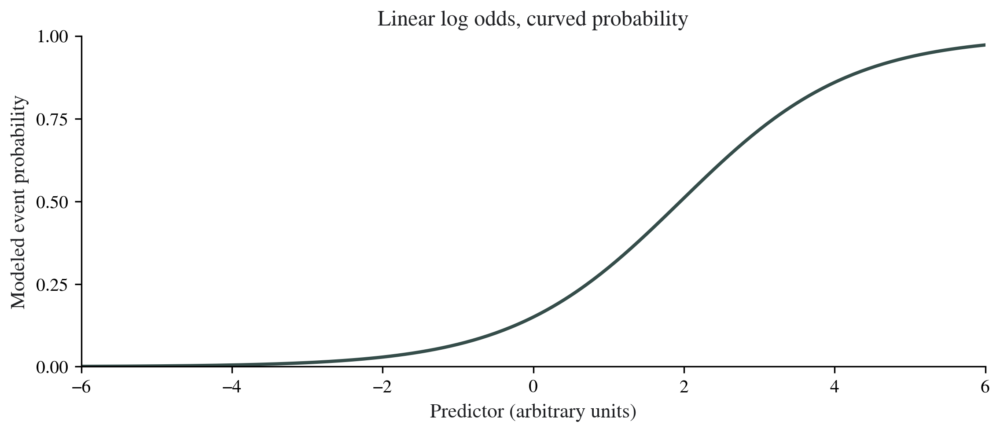

# Introduction to Logistic Regression {#sec-logistic-regression}

## Learning objectives

After this chapter, the reader should be able to define a binary outcome and its event category, distinguish probability from odds, interpret a coefficient as an odds ratio, and recognise the limits of a simple unadjusted binary-outcome model.

## The scope of this chapter

This is an introductory bridge from Volume I to Volume II. It explains the binary-outcome scale and a model with one predictor. Multiple predictors, confounder selection, interaction, detailed diagnostics, penalised estimation, and prediction-model validation belong to later volumes.

The chapter connects a contingency-table odds ratio with a regression coefficient. Its introductory role supports interpretation of the binary-outcome scale before moving to adjusted modeling.

## A binary outcome needs a defined event

A binary outcome has two defined categories. Write which category is the event being modeled and which is the comparison. A model of event presence and a model of event absence describe complementary probabilities and reverse the odds-ratio direction.

For teaching, code event present as $Y=1$ and event absent as $Y=0$. The probability $p=P(Y=1\mid X)$ is the conditional event probability. In software, verify the actual event and reference labels in the output; do not infer them from a remembered default.

The observation unit and outcome window remain essential. One record per participant with a known event status is different from several visits per participant. A binary variable can be entered into the software in both situations, but the same simple independence model is not automatically appropriate.

## Probability, odds, and log odds

Probability ranges from zero to one. Odds are

$$
\text{odds}=\frac{p}{1-p}.
$$

If the event probability is 0.15, the odds are 0.15/0.85 = 0.1765. A probability of 0.30 gives odds of 0.30/0.70 = 0.4286. The probability ratio is 2.00, while the odds ratio is 2.43. The measures describe different scales. [@BMJOdds]

The natural logarithm of the odds is the **logit**:

$$
\operatorname{logit}(p)=\log\left(\frac{p}{1-p}\right).
$$

Unlike probability, log odds can vary over the full numerical line. Logistic regression models that transformed quantity and maps it back to a probability between zero and one.

## The simple logistic model

With one predictor,

$$
\log\left(\frac{p_i}{1-p_i}\right)=\beta_0+\beta_1X_i.
$$

The corresponding event probability is

$$
p_i=\frac{\exp(\beta_0+\beta_1X_i)}{1+\exp(\beta_0+\beta_1X_i)}.
$$

The binomial family with a logit link is a documented generalised linear model specification. R's family and model documentation distinguish the response distribution from its link function. [@RFamily; @RGlm]

A one-unit predictor increase adds $\beta_1$ to the log odds and multiplies the odds by $\exp(\beta_1)$. It does not add a fixed amount to the event probability. The probability change depends on the starting probability and the model.

## A binary predictor connects the model to a table

Return to the invented independent-group table: 30 events among 100 participants in A and 15 among 100 in B. Let $X=0$ for B and $X=1$ for A.

The intercept is the log odds in B:

$$
\beta_0=\log(15/85)=-1.7346.
$$

The group coefficient is the log odds ratio:

$$
\beta_1=\log\left(\frac{30/70}{15/85}\right)=0.8873.
$$

Exponentiating gives $\exp(0.8873)=2.4286$. Transforming the linear predictor back to probability gives 0.15 for B and 0.30 for A. This reproduces the two observed teaching proportions in the simple two-group model.

The coefficient is unadjusted because the model contains only group. It should not be described as an association independent of age, severity, or other characteristics.

## A continuous predictor and the probability curve

For a continuous predictor, the model assumes a straight-line relationship between that predictor and the log odds in this simple specification. It does not assume a straight-line relationship with the raw event probability. A one-unit effect on the odds can correspond to different absolute probability changes at different starting probabilities.

{#fig-logistic-curve width=100% fig-alt="A smooth S-shaped curve shows event probability increasing with an arbitrary predictor while remaining between zero and one."}

State the predictor unit and consider a clinically understandable scaling before reporting a coefficient. A coefficient per year and one per decade differ numerically because the unit differs. Their odds ratios must be interpreted on the stated increment.

## Confidence intervals and p-values

A common large-sample Wald interval is first calculated for the log-odds coefficient, then exponentiated to the OR scale. The no-association coefficient is zero; the corresponding OR is one. Other interval procedures may be appropriate, so identify the method rather than assuming all intervals are Wald intervals.

For the invented table, the group coefficient is 0.8873 with SE 0.3550. Its Wald z statistic is 2.499, p = 0.0124, and the exponentiated 95% interval is 1.21 to 4.87. These are calculated teaching values from the single-predictor table, not results of an author-supplied jamovi dataset.

The Wald p-value differs from the Pearson and Fisher p-values in the categorical chapter because these procedures use different test calculations. The relevant question is whether the selected procedure and its assumptions are appropriate, not which value is most favourable.

## Basic model checks

Check event coding, predictor coding, reference category, analytical sample, and observation independence. For continuous predictors, assess whether the linear logit form is appropriate. Consider whether the data provide enough event and non-event information for the model being fitted.

Binary outcomes do not have normally distributed errors in the ordinary linear-model sense. A normality test of the 0/1 outcome is therefore not a prerequisite for logistic regression. The binomial variance changes with probability, and the model uses that response structure. [@RFamily]

Very sparse combinations or separation can produce unstable or diverging coefficient estimates. Separation occurs when predictor information divides event from non-event status perfectly in a way that prevents a finite ordinary maximum-likelihood estimate. Unusually large estimates, broad intervals, or fitting warnings require investigation rather than uncritical interpretation. [@RGlm]

Do not use a rigid event-count rule as proof that a model is adequate. The information, complexity, predictor distributions, and intended use matter. Detailed strategy for limited information and more complex models is reserved for Volume II and III.

## Association and prediction are different objectives

An association analysis focuses on the predictor contrast and its interpretation. A prediction model focuses on estimating an individual's outcome probability in a specified setting. A significant OR does not by itself show that prediction is accurate or clinically useful.

Prediction requires assessment of calibration, discrimination, and validation appropriate to the use. A classification accuracy at one cutoff can be misleading when the event is uncommon, and the cutoff has to serve a specified decision. This chapter does not claim to validate a clinical prediction tool.

Pseudo-$R^2$ measures in logistic output are not interchangeable with the ordinary linear model's $R^2$. Do not label them as the literal percentage of individual outcome variation explained without identifying their definition.

## Design affects interpretation of fitted probabilities

The teaching table stipulates complete common follow-up and supports its stated risk interpretation. In outcome-based sampling, the sampled event fraction does not directly reproduce the population event probability. An odds-ratio analysis may remain relevant, but absolute risks require additional design information and an appropriate method.

Likewise, a before–after binary outcome or matched case-control design requires recognition of pairing or matching. A simple unadjusted independent logistic model should not be transplanted into those structures without extension.

## Reading jamovi output

Confirm the binary outcome, modeled event, reference level, and single predictor. Distinguish the coefficient on the log-odds scale from its exponentiated OR. Read the interval, SE or test quantity, analytical sample, and relevant model notes. jamovi's logistic documentation describes coefficient, odds-ratio, and model-fit outputs. [@jamoviLogistic]

The complete procedure, dataset, and screenshots will be added in the empty Hands-on box. This introductory text supports interpretation of that output; it does not claim that the missing practical demonstration has already been performed.

## Reporting example

For the teaching table: "In a simple unadjusted logistic model with group B as reference, group A had higher event odds (OR 2.43; Wald 95% CI 1.21–4.87; p = 0.012). The model represents 200 invented participant outcomes, including 45 events. The OR compares odds, not risks, and no other predictors were included."

For an actual manuscript, state the event definition and time window, reference category, selected model, missing-data handling, and design limitations. Avoid replacing "odds" with "risk" merely to simplify the sentence.

## Hands-on {#hands-on-logistic-regression}

::: {.callout-note .hands-on-note title="jamovi workspace" icon=false}
<!-- Author: add the introductory binary-outcome dataset, event coding, model, and screenshots here. -->
:::

::: {.review-questions}

## Review questions

1. What is the OR when a coefficient on the log-odds scale is zero?
2. Does OR = 2 mean that event probability doubles?
3. What must be verified before interpreting the direction of a software coefficient?
4. Does the one-predictor teaching model adjust for age or other characteristics?

:::

::: {.review-answers}

## Answers and reasoning

1. $\exp(0)=1$, the no-association value.
2. No. It means that odds double; the corresponding probability change depends on the initial probability.
3. Verify the modeled event, predictor coding, and reference category.
4. No. It contains group only and is unadjusted.

:::
